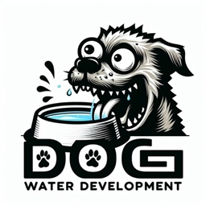

# DWD WoW Forever Addon Pack



A CurseForge-recognized addon pack for **World of Warcraft: Forever 1.60.1**
(interface 16001). Version **v1.0.14** contains **26 addon folders from 21
CurseForge projects**, including official Bartender4, Questie, QuestieDB, and
all six DWD addons. Bundled modules appear under their parent project.

**[Download the addon ZIP](https://github.com/dellmas/DWD-WoW-Forever-Addons/releases/latest/download/DWD-Forever-Addons.zip)**

[Release notes](https://github.com/dellmas/DWD-WoW-Forever-Addons/releases/latest)
| [Installation instructions](INSTALL.txt)
| [Addon versions](ADDON-VERSIONS.json)
| [CurseForge projects and file hashes](CURSEFORGE-PROJECTS.json)

The download is public and requires no GitHub account. Download the release
ZIP above; GitHub's automatic Source code archives do not contain the pack.

## Profile addons removed

DWD Profiles and its Early Loader are retired and are no longer included.
Remove `DWD_Profiles` and `!DWD_Profiles_Loader` from your `Interface/AddOns`
folder if you previously installed them. Also remove the obsolete
`DWD_Profiles_Recovery` helper if present. Leave `WTF` intact: your normal
addon settings and inactive saved profile data are retained.

The previous public ZIP downloads and legacy updater feeds have also had
these addons removed. Each remaining addon saves its own settings.

## Mob Kill Counter attribution

Mob Kill Counter 0.0.1-forever.25 credits NPC killing blows from the player,
their pet, or their vehicle. The addon skips events when Forever hides either
unit's identity. Your settings and existing totals are preserved. Run `/reload`
after updating.

## Consistent DWD names and logo

All six DWD addons now use the same Dog Water Development logo and consistent
`DWD`-prefixed display names. Party XP is **DWD Party XP**, with Bars removed.
CurseForge project names/logos and the in-game addon-list metadata match.
New branding files have been submitted; moderation or app caching may delay
the update on another installation. Reload/restart WoW to refresh metadata.

Folder names, project IDs, saved-variable contracts, Lua code and existing
resources remain unchanged. The same logo is included in each addon, with no
new cross-addon dependency. See [branding standards](BRANDING.md).

## Previous addition: Bagnon inventory stays open

DWD Bagnon Helper - Forever 1.0.0-forever.1 keeps Bagnon inventory open until
you click its close X. Map maximization, Escape, bag toggles, and interaction
close requests leave inventory open. Bag keys still open a closed inventory.
Bank windows and other UI windows keep their usual behavior. The X stays
available with skins that normally hide it.

Restart WoW to discover this new addon folder, and enable both the helper and
Bagnon. `/dwdbags` shows status. Disable the helper and reload to restore
normal closing. Bagnon/BagBrother files and saved settings remain unchanged.
Twenty Lua 5.1 checks exercise the installed 12.1.8 window-management code;
the live result still needs checking in-game. Global UI hiding, loading,
logout, and UI restarts remain under WoW's control. Protected native bypasses
in combat wait until combat ends to restore the window.

The new CurseForge project and file require moderation before app detection.
Install this helper from the full ZIP or CurseForge; the legacy updater does
not include newly added addon names.

[Helper source](source/Forever/DWD_BagnonHelper-Forever)

## Previous fix: MobCount player tooltip counts

MobCount 0.0.1-forever.23 fixes an unrelated mob's Total Killed line appearing
on player tooltips during combat. It resolves the creature actually displayed
by the tooltip and excludes players and pets. If Forever hides the identity
or reaction, it omits the count until those values are readable. It never
substitutes the last selected target. Saved totals and settings are preserved.

Run `/reload` after updating. Eighteen Lua 5.1 checks passed, including the
original player-tooltip bug, different hovered creatures, secret identities,
party-frame hovers, postcombat corpse credit, and avoiding aura rebuilds.
The live result still needs an in-game check. CurseForge approval/indexing
may delay updates in its app.

[MobCount source](source/Forever/DWD_MobCount)

## Previous fix: Tooltip Mover scale and config

Tooltip Mover 1.1.0-forever.9 preserves the tooltip's screen anchor when changing
scale. Its config panel displays the current scale, font size, and selected
font immediately. The quest-progress move button has its own row below the
font dropdown. Opening config does not overwrite saved settings.

After updating, run `/reload` and `/ttmove config`. Eleven Lua 5.1 regression
checks passed, including scaled UI geometry, cursor anchoring, first-open
values, and layout spacing. The live UI still needs an in-game check.
The new CurseForge file may need approval/indexing before the app offers it.

[Tooltip Mover source](source/Forever/DWD_TooltipMover)

## Previous fix: warrior and paged action bars

RankUp 1.3.0-forever.2 places newly learned abilities on empty visible buttons,
following the actual Bartender/Blizzard stance or bar page. Success messages
identify the visible destination; hidden raw slot numbers are no longer the
default. Existing explicit raw-slot ranges remain available as an option.

To recover an already learned Battle Shout placed on a hidden page, run these
commands separately. Existing hidden copies and other bar contents remain:

```text
/reload
/dwdrank place Battle Shout
```

Use `/dwdrank visible` to restore visible-button placement after setting a custom
slot range. Forty regression tests passed, including warrior stance paging,
combat/cursor deferral, native bars, the current Bartender `GetAction` method,
and detecting a page change during placement. Actual in-game placement still
requires loading the update and checking the visible result.

## Let CurseForge monitor updates

1. Close WoW and back up your `Interface/AddOns` and `WTF` folders.
2. Replace each included addon folder with its clean copy from `AddOns` in
   the ZIP. Move previous folders into a backup outside `Interface/AddOns`
   first so leftover beta files do not interfere with recognition.
3. If present, also archive `Bartender4_Forever`, `DWD_Profiles_Recovery`, and
   `DWD_UpdaterStatus`. They are not part of this pack. Official `Bartender4`
   replaces the beta port; the beta layout requires a separate settings
   migration before switching. Never enable both Bartender copies.
4. In CurseForge, select **World of Warcraft > Forever**, then open the
   three-dot menu beside Run Game and choose **Scan addons folder > Scan**.
5. Check **My Addons**. The included folders are supplied by 21 CurseForge projects. Approval/indexing can affect detection elsewhere;
   refresh or rescan after processing completes.

The addon files are unchanged copies of their CurseForge release archives.
Original author and license notices are retained. The version and provenance
manifests identify every packaged file; no local compatibility patches are
applied to third-party addons.

## Settings

The ZIP contains no `WTF`, account data, personal saved settings, bundled
Main1/Main2 layouts, filesystem junctions, or error logs. Leave your own `WTF`
folder intact. Existing personal DWD profiles stay in your SavedVariables.
This download does not migrate layouts from the old beta Bartender database.

## DWD addons

- DWD Bagnon Helper: inventory closes only when its X is clicked.
- DWD Mob Kill Counter: unit-tooltip kill counts, including the aura-taint fix.
- DWD Party XP: party XP exchange and sync diagnostics.
- DWD Tooltip Mover: configurable tooltip positioning.
- DWD Party Highlight: party target and friendly nameplate decorations.
- DWD RankUp: rank upgrades and newly learned active abilities on action slots.

Use `/dwdxp`, `/dwdmc`, `/ttmove`, and `/dwdrank` for help.
Enable both Questie and QuestieDB. Restart or reload WoW after an update as
required; a reload cannot discover a newly installed addon folder.

## Older DWD desktop updater

Use CurseForge for this pack. If the old DWD desktop updater is enabled, click
**Disable Auto Updates** before switching so both tools do not replace the
same folders. Disabling startup retains addon settings and backups.

The legacy source and compatibility release assets remain available for
existing installations. That updater has a fixed allowlist and does not manage
all addons in this pack. See [legacy updater notes](updater/README.txt).

## RankUp source

DWD RankUp is maintained by dellmas. The Forever port adapts the author's
original Classic Era DWD_RankUp 1.2.0 addon.

- [Original Classic Era source](source/ClassicEra/DWD_RankUp)
- [Current Forever source](source/Forever/DWD_RankUp-Forever)

The original Classic Era installation is preserved. These source directories
are for browsing; install the release ZIP for the complete pack.
